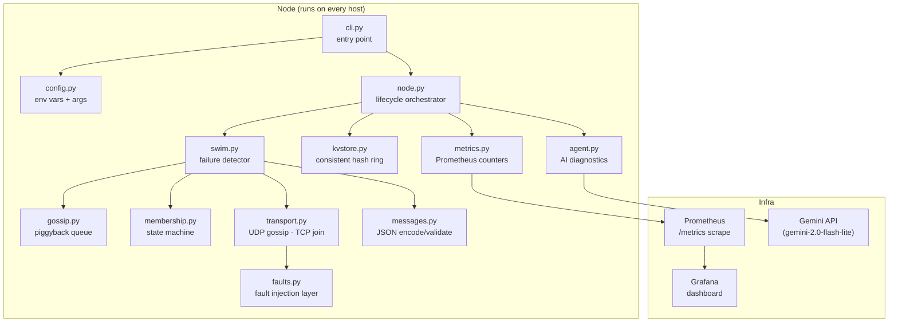

# SwimCluster

A self-healing distributed cluster membership system built on the **SWIM protocol**
(Scalable Weakly-consistent Infection-style process group Membership),
with a consistent-hashing key-value service, Prometheus metrics, and an
AI-powered incident-diagnostics agent.

---

## Architecture



---

## Quick Start

The project targets Python 3.11.

### Run tests locally

```bash
# For Windows users:
py -3.11 -m pip install -r requirements.txt
pytest

# Or on Linux / macOS:
pip install -r requirements.txt
pytest
```

### Start the cluster with Docker Compose

1. Build and start all 5 nodes in the background:
   ```bash
   docker compose up --build -d
   ```

   This starts:
   | Service      | Host URL                     | Description |
   |--------------|------------------------------|-------------|
   | node1        | http://localhost:8081        | SWIM Seed Node (HTTP API & metrics) |
   | node2        | http://localhost:8082        | Cluster Member 2 |
   | node3        | http://localhost:8083        | Cluster Member 3 |
   | node4        | http://localhost:8084        | Cluster Member 4 |
   | node5        | http://localhost:8085        | Cluster Member 5 |
   | Prometheus   | http://localhost:9090        | Metrics collector (targets: http://localhost:9090/targets) |
   | Grafana      | http://localhost:3000        | Dashboard (login: `admin` / `swimcluster`) |

2. Check cluster membership:
   ```bash
   curl http://localhost:8081/members
   ```

3. Test failure detection and recovery:
   ```bash
   # Stop node3 (observed as SUSPECT then DEAD by peers)
   docker compose stop node3

   # Restart node3 (rejoins with a higher timestamp incarnation and transitions back to ALIVE)
   docker compose start node3
   ```

4. Check Prometheus targets and Grafana:
   - Prometheus targets: http://localhost:9090/targets
   - Grafana dashboard: http://localhost:3000

---

## Metrics

Prometheus metrics are exposed at `/metrics` on each node's HTTP port (e.g. `http://localhost:8081/metrics` for `node1`).

- `swimcluster_suspect_events_total` and `swimcluster_dead_events_total` count only transitions this node itself observed (it ran the suspicion timer). A node that learns a state from gossip does not increment them.
- To get a cluster-wide count in Prometheus use `sum(swimcluster_dead_events_total)` across nodes, not a single node's value.
- `members_alive`, `members_suspect`, `members_dead` show this node's current view of the cluster.
- `convergence_time_seconds` measures time from first SUSPECT to DEAD as observed by this node.

---

## Failure Testing

There are two primary ways to test failure detection:
1. `docker compose stop <node>` / `docker compose start <node>`
2. `docker compose pause <node>` / `docker compose unpause <node>`

Restart reliably recovers a node declared DEAD; pause/unpause recovery is best-effort, because a DEAD node is not probed and does not learn of its own death unless another node contacts it.

When a node restarts (`docker compose start`), it calculates a new startup incarnation based on the current Unix timestamp (`int(time.time())`) and connects via TCP to seeds to rejoin, ensuring that peer nodes accept the new ALIVE state over any stale DEAD record.

---

## Fault Injection

`POST` / `DELETE` `/admin/faults` applies only to the node that receives the request. A partition added on `node1` blocks `node1`'s traffic with the partitioned peer; it does not automatically apply on `node3`.

In a multi-node cluster, indirect probes can keep a partitioned node ALIVE, which is intended SWIM behavior (indirect helpers that can still reach the target refute the suspicion).

### Partitioning a node pair on both nodes

**Bash:**
```bash
# Partition node1 and node3 on both nodes
curl -X POST http://localhost:8081/admin/faults \
  -H 'Content-Type: application/json' \
  -d '{"partition_add": ["node1", "node3"]}'

curl -X POST http://localhost:8083/admin/faults \
  -H 'Content-Type: application/json' \
  -d '{"partition_add": ["node1", "node3"]}'

# Clear faults on both nodes
curl -X DELETE http://localhost:8081/admin/faults
curl -X DELETE http://localhost:8083/admin/faults
```

**PowerShell:**
```powershell
# Partition node1 and node3 on both nodes
Invoke-RestMethod -Method Post -Uri http://localhost:8081/admin/faults -ContentType "application/json" -Body '{"partition_add": ["node1", "node3"]}'
Invoke-RestMethod -Method Post -Uri http://localhost:8083/admin/faults -ContentType "application/json" -Body '{"partition_add": ["node1", "node3"]}'

# Clear faults on both nodes
Invoke-RestMethod -Method Delete -Uri http://localhost:8081/admin/faults
Invoke-RestMethod -Method Delete -Uri http://localhost:8083/admin/faults
```

### Packet Loss and Delays

```bash
# Set 30% packet loss on node1
curl -X POST http://localhost:8081/admin/faults \
  -H 'Content-Type: application/json' \
  -d '{"loss_prob": 0.3}'

# Reset all faults on node1
curl -X DELETE http://localhost:8081/admin/faults
```

---

## Key-Value Store

Each node exposes a basic HTTP key-value store:
- `PUT /kv/{key}` – write a string value (raw request body)
- `GET /kv/{key}` – read the stored value
- `DELETE /kv/{key}` – delete a key

Each node keeps its own local copy of data; consistent hashing computes an owner per key, which is reported in responses, but requests are not forwarded to the owner and data is not migrated when membership changes.

Example:
```bash
# Write to node1
curl -X PUT http://localhost:8081/kv/mykey -d "hello world"

# Read back from node1
curl http://localhost:8081/kv/mykey

# Delete from node1
curl -X DELETE http://localhost:8081/kv/mykey
```

---

## AI Diagnostics Agent

The agent is a read-only CLI tool that uses Google Gemini (`gemini-2.0-flash-lite`) via `GEMINI_API_KEY` to analyze incident logs and Prometheus metrics. It never mutates cluster state.

### Shared Event Logs
Each node writes events (e.g. `SUSPECT`, `DEAD`, `ALIVE_REFUTATION`) to `events-<node_id>.jsonl` under `/app/data` (mounted to `./data` on the host in `docker-compose.yml`). The agent reads all `events-*.jsonl` files in the directory to analyze cluster-wide incidents.

### Running the Agent
The agent is implemented; run it with `GEMINI_API_KEY` set to try it:

```bash
export GEMINI_API_KEY="AIza..."
swimcluster agent --window 5m --metrics-url http://localhost:8081/metrics --event-log ./data
```

The agent outputs structured JSON:
```json
{
  "summary": "node3 failed and was marked DEAD after 3.2 s.",
  "likely_cause": "The node process exited unexpectedly.",
  "evidence": ["SUSPECT event at ts=…", "DEAD event at ts=…"],
  "suggested_checks": ["Check container logs", "Review OOM killer output"]
}
```

---

## Limitations

- **No Kubernetes**: Single-host Docker Compose deployment only; no Helm charts or Kubernetes CRDs.
- **Single-host Docker Compose only**: Network configurations assume local container networking (`swimnet`).
- **No authentication**: HTTP admin (`/admin/faults`), membership (`/members`), and KV (`/kv/*`) endpoints are unauthenticated.
- **No persistence**: Node membership and key-value state reside purely in memory and reset on restart.
- **KV store is not replicated or routed**: Keys are stored locally on whichever node receives the request; ownership calculation is informational only.
- **No production hardening**: Intended as an educational and experimental SWIM implementation.

---

## Project Structure

```
swimcluster/
├── __init__.py        package version
├── config.py          env-var + CLI settings
├── messages.py        SWIM wire format, encode/decode, validation
├── membership.py      member state, incarnation, conflict resolution
├── swim.py            failure detector: probe → indirect → suspect → dead
├── gossip.py          piggyback queue (bounded retransmit)
├── transport.py       UDP gossip · TCP join · InMemoryTransport for tests
├── node.py            lifecycle orchestrator, HTTP server
├── kvstore.py         consistent-hash KV store
├── faults.py          packet loss · delay · partitions
├── metrics.py         Prometheus counters/gauges/histogram
├── agent.py           AI diagnostics (GeminiProvider + FakeLLMProvider)
└── cli.py             swimcluster node / fault / agent commands
tests/
├── test_messages.py
├── test_membership.py
├── test_swim.py       (uses InMemoryTransport, no real sockets)
├── test_kvstore.py
└── test_faults.py
Dockerfile             multi-stage, non-root user
docker-compose.yml     5 nodes + Prometheus + Grafana
prometheus.yml
grafana/
  dashboards/swimcluster.json
  provisioning/
pyproject.toml
requirements.txt
.github/workflows/ci.yml
README.md
docs/design-notes.md
```

---

## Environment Variables

| Variable                  | Default          | Description                        |
|---------------------------|------------------|------------------------------------|
| `SWIM_NODE_ID`            | `""`             | Unique node identifier             |
| `SWIM_HOST`               | `0.0.0.0`        | Bind address                       |
| `SWIM_PORT`               | `7946`           | UDP/TCP port                       |
| `SWIM_HTTP_PORT`          | `8080`           | HTTP API port                      |
| `SWIM_SEEDS`              | `""`             | Comma-separated `host:port` seeds  |
| `SWIM_PROTOCOL_PERIOD`    | `1.0`            | Seconds per probe round            |
| `SWIM_PING_TIMEOUT`       | `0.5`            | Direct ACK timeout (s)             |
| `SWIM_PING_REQ_TIMEOUT`   | `1.0`            | Indirect ACK timeout (s)           |
| `SWIM_SUSPICION_MULT`     | `3`              | Suspicion timer multiplier         |
| `SWIM_INDIRECT_K`         | `3`              | Number of indirect-probe helpers   |
| `GEMINI_API_KEY`          | `""`             | API key for the diagnostics agent  |

---

## Running a Node Manually

```bash
# Seed node
SWIM_NODE_ID=node1 SWIM_PORT=7946 SWIM_HTTP_PORT=8080 swimcluster node

# Peer joining the seed
SWIM_NODE_ID=node2 SWIM_PORT=7947 SWIM_HTTP_PORT=8081 \
  SWIM_SEEDS=localhost:7946 swimcluster node
```
