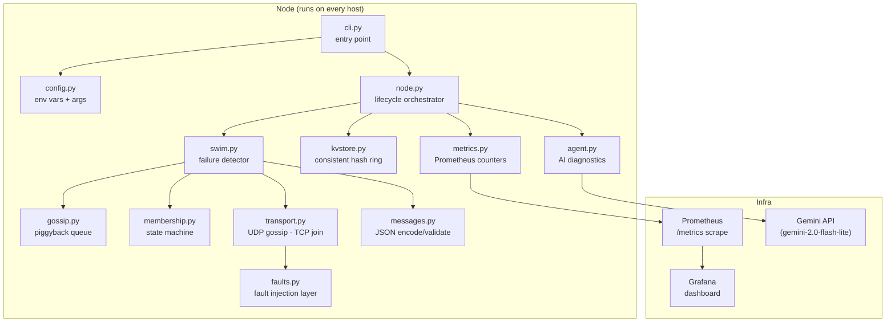

# SwimCluster

A self-healing distributed cluster membership system built on the **SWIM protocol**
(Scalable Weakly-consistent Infection-style process group Membership),
with a consistent-hashing key-value service, Prometheus metrics, and an
AI-powered incident-diagnostics agent.

---

## Architecture



---

## Quick Start

The project targets Python 3.11.

### Run tests

```bash
pip install -r requirements.txt
# For Windows users:
py -3.11 -m pip install -r requirements.txt

pytest --tb=short -v
```

### Start the cluster with Docker Compose

```bash
docker compose up --build
```

This starts:
| Service      | Host URL                     |
|--------------|------------------------------|
| node1        | http://localhost:8081        |
| node2        | http://localhost:8082        |
| node3        | http://localhost:8083        |
| node4        | http://localhost:8084        |
| node5        | http://localhost:8085        |
| Prometheus   | http://localhost:9090        |
| Grafana      | http://localhost:3000 (admin / swimcluster) |

### Inspect cluster membership

```bash
curl http://localhost:8081/members | python -m json.tool
```

### Use the KV store

```bash
# Write a value
curl -X PUT http://localhost:8081/kv/mykey -d "hello world"

# Read it back
curl http://localhost:8081/kv/mykey

# Delete it
curl -X DELETE http://localhost:8081/kv/mykey
```

### Inject a partition between node1 and node3

```bash
curl -X POST http://localhost:8081/admin/faults \
  -H 'Content-Type: application/json' \
  -d '{"partition_add": ["node1", "node3"]}'
```

### Heal the partition

```bash
curl -X POST http://localhost:8081/admin/faults \
  -H 'Content-Type: application/json' \
  -d '{"partition_remove": ["node1", "node3"]}'
```

### Set packet loss to 30 %

```bash
curl -X POST http://localhost:8081/admin/faults \
  -H 'Content-Type: application/json' \
  -d '{"loss_prob": 0.3}'
```

### Clear all faults

```bash
curl -X DELETE http://localhost:8081/admin/faults
```

### Run the AI diagnostics agent

```bash
export GEMINI_API_KEY="AIza..."
swimcluster agent --window 5m --metrics-url http://localhost:8081/metrics
```

The agent produces JSON:

```json
{
  "summary": "node3 failed and was marked DEAD after 3.2 s.",
  "likely_cause": "The node process exited unexpectedly.",
  "evidence": ["SUSPECT event at ts=…", "DEAD event at ts=…"],
  "suggested_checks": ["Check container logs", "Review OOM killer output"]
}
```

---

## Project Structure

```
swimcluster/
├── __init__.py        package version
├── config.py          env-var + CLI settings
├── messages.py        SWIM wire format, encode/decode, validation
├── membership.py      member state, incarnation, conflict resolution
├── swim.py            failure detector: probe → indirect → suspect → dead
├── gossip.py          piggyback queue (bounded retransmit)
├── transport.py       UDP gossip · TCP join · InMemoryTransport for tests
├── node.py            lifecycle orchestrator, HTTP server
├── kvstore.py         consistent-hash KV store
├── faults.py          packet loss · delay · partitions
├── metrics.py         Prometheus counters/gauges/histogram
├── agent.py           AI diagnostics (GeminiProvider + FakeLLMProvider)
└── cli.py             swimcluster node / fault / agent commands
tests/
├── test_messages.py
├── test_membership.py
├── test_swim.py       (uses InMemoryTransport, no real sockets)
├── test_kvstore.py
└── test_faults.py
Dockerfile             multi-stage, non-root user
docker-compose.yml     5 nodes + Prometheus + Grafana
prometheus.yml
grafana/
  dashboards/swimcluster.json
  provisioning/
pyproject.toml
requirements.txt
.github/workflows/ci.yml
README.md
docs/design-notes.md
```

---

## Environment Variables

| Variable                  | Default          | Description                        |
|---------------------------|------------------|------------------------------------|
| `SWIM_NODE_ID`            | `""`             | Unique node identifier             |
| `SWIM_HOST`               | `0.0.0.0`        | Bind address                       |
| `SWIM_PORT`               | `7946`           | UDP/TCP port                       |
| `SWIM_HTTP_PORT`          | `8080`           | HTTP API port                      |
| `SWIM_SEEDS`              | `""`             | Comma-separated `host:port` seeds  |
| `SWIM_PROTOCOL_PERIOD`    | `1.0`            | Seconds per probe round            |
| `SWIM_PING_TIMEOUT`       | `0.5`            | Direct ACK timeout (s)             |
| `SWIM_PING_REQ_TIMEOUT`   | `1.0`            | Indirect ACK timeout (s)           |
| `SWIM_SUSPICION_MULT`     | `3`              | Suspicion timer multiplier         |
| `SWIM_INDIRECT_K`         | `3`              | Number of indirect-probe helpers   |
| `GEMINI_API_KEY`          | `""`             | API key for the diagnostics agent  |

---

## Running a Node Manually

```bash
# Seed node
SWIM_NODE_ID=node1 SWIM_PORT=7946 SWIM_HTTP_PORT=8080 swimcluster node

# Peer joining the seed
SWIM_NODE_ID=node2 SWIM_PORT=7947 SWIM_HTTP_PORT=8081 \
  SWIM_SEEDS=localhost:7946 swimcluster node
```
